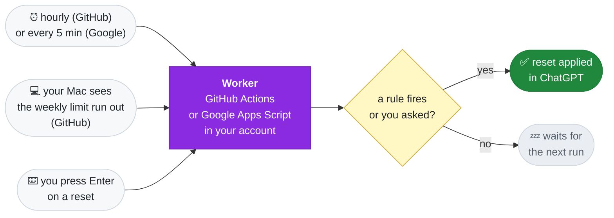

<div align="center">


### AUto-RESets for Codex

Applies your issued ChatGPT rate-limit resets so they don't go to waste.<br>
Runs in your own account — GitHub Actions or Google Apps Script. Your Mac can be off.

[](https://github.com/Keshaqaz/aures/releases/latest)
[](docs/installation.en.md)
[](docs/installation.en.md)
[](LICENSE)

**English** · [Русский](docs/README.ru.md)


</div>

## Features

- **No reset expires unused.** The worker applies a reset before it expires: within the last 8 hours on GitHub, the last hour on Google.
- **Weekly limit hit — reset within minutes.** An optional rule applies the reset that expires first. On Google the worker checks the limit itself every 5 minutes, even with the Mac off; on GitHub, while the Mac is awake, it checks the weekly limit every 2 minutes and calls the worker as soon as it runs out, whichever client used it up: Codex, opencode, your phone.
- **One screen.** `aures` shows the resets on top and the rules below. Enter on a reset applies it now, regardless of the rules; Enter on a rule switches it. `Tab` opens the «Worker» screen: the platform with its state, the accounts, «Check now» (a trial run that applies nothing), «Repair» (deploys this version of the worker again and brings its schedule back), «Pause» (the schedule off; «Apply now» still works), «Switch to …» (the other platform without a reinstall) and the live journal of the worker, polled while the screen is open. The screen, pause and switching are detailed in the [guide](docs/installation.en.md).
- **No servers, no subscriptions.** Everything in your account: GitHub Actions (up to ~750 of the 2,000 free minutes a month) or Google Apps Script (~5–10 of the 90 free trigger-minutes a day).
- **Codex on your Mac is untouched.** The worker and the Mac check have ChatGPT sign-ins of their own; nothing is copied from Codex.

> [!IMPORTANT]
> ### 🔒 Your tokens never leave your accounts
>
> AURES has no server of its own and collects nothing. Everything runs on **your** Mac and in **your** account — GitHub or Google:
>
> - **Platform sign-ins** — GitHub and, on Google, the Google sign-in and the worker secret — stay in your Mac's Keychain.
> - **The worker's ChatGPT sign-in** on GitHub lives in your private repo, encrypted with AES-256-GCM; the key is an Actions secret that only your own workflow can read. On Google it lives in your script project's properties, unencrypted — a key would sit right next to it; the worker's web app answers only requests with the secret from your Keychain and never returns tokens.
> - **The Mac check's ChatGPT sign-in** stays in a file on your Mac.
> - The CLI and the worker talk to GitHub, Google and OpenAI only. No telemetry, no third parties, not even the author.
>
> The code is open: see for yourself in [src/](src/).

## Quick start

```sh
brew install keshaqaz/tap/aures
aures setup
```

`setup` asks where the worker will run — Google Apps Script (every 5 minutes) or GitHub Actions (about once an hour) — and goes in stages, one line each: `[1/4] Platform`, `[2/4] Signing in to Google`, `[3/4] The worker on Google`, `[4/4] Signing in to ChatGPT`. It opens every page itself, and when it is done the main screen opens. What to click on each Google screen is in the [guide](docs/installation.en.md#quick-install).


The CLI speaks your Mac's language — Russian on a Russian locale, English on any other; `l` on the screen or `aures language` switches it.

Full guide, including installing from source: [docs/installation.en.md](docs/installation.en.md).

## Commands

| Command | What it does |
| --- | --- |
| *(no command)* | the screen: resets and rules; Enter applies a reset or switches a rule; `Tab` — the «Worker» screen: check, repair, pause, switch platform, the journal |
| `setup` | install, or finish an interrupted install; asks for the platform |
| `status` | the same overview printed once: resets, rules, worker health and the Mac check |
| `apply-now` | apply a chosen reset now |
| `rules` | choose when resets are applied |
| `login` | sign the worker in to ChatGPT again |
| `upgrade` | update the worker after a new version |
| `uninstall` | remove the worker, the Mac check and the sign-ins |
| `language en` / `language ru` | the language of the CLI; `l` on the screen does the same |

## The «Worker» screen

`Tab` on the screen opens the worker itself, on either platform:

<div align="center">

</div>

- **Worker** — the platform, its state (active, on pause, switch unfinished) and a link to the repo or the script project.
- **Accounts** — the GitHub or Google account and the worker's ChatGPT sign-in; Enter on either signs in again.
- **Actions** — «Check now» (a trial run that applies nothing), «Repair» (deploys this version of the worker again and brings its schedule back), «Pause» / «Unpause» (the schedule off and back on; «Apply now» still works on pause) and «Switch to …» (moves the worker to the other platform, no reinstall).
- **Journal** — the last runs of the worker, newest first: what started each run and how it ended. It is polled while the screen is open: every 30 seconds on Google, every minute on GitHub.

Details in the [guide](docs/installation.en.md#the-worker-screen).

## How it works



**The worker** lives on the platform you pick at setup: GitHub Actions runs it about once an hour (with delays), Google Apps Script every 5 minutes. It checks the resets against the rules and applies one when it's due. The Mac isn't needed for that: it only installs and controls the worker.

**The Mac check** is a launchd agent that runs while the weekly rule is on (on GitHub). It reads the weekly limit with the Mac's own ChatGPT sign-in and, once the limit runs out, starts the worker right away instead of waiting for the scheduled run. The Mac never applies a reset itself: the worker reads the limit again and decides by the same rules. On Google no check is needed: the worker itself watches the limit every 5 minutes. Design: [ADR-0005](docs/adr/0005-weekly-check-from-mac.md).

| Rule | Default | When a reset is applied |
| --- | --- | --- |
| Before expiry | on | less than 8 hours are left before it expires on GitHub, or less than one hour on Google |
| When the weekly limit runs out | on on Google, off on GitHub | the weekly limit is used up; the reset that expires first goes |

Both rules cover all resets and work independently; change them with `aures rules`.

## Limitations

- **On GitHub the timing is approximate.** GitHub delays and skips scheduled runs, sometimes for hours. That's why the before-expiry rule works within an 8-hour window there, not at an exact minute. On Google the worker runs every 5 minutes, and the window is one hour.
- **The Mac check (GitHub) works only while the Mac is awake** and you are logged in to it. Otherwise the scheduled run applies the reset, hours later. On Google no check is needed: the worker itself notices the end of the limit every 5 minutes.
- **One more ChatGPT code (GitHub).** Turning the weekly rule on signs this Mac in to ChatGPT; the sign-in is kept in a file readable by your macOS user, and stays there when the rule is off; `aures uninstall` revokes it.
- **Paid ChatGPT plan required**, with 5-hour and weekly limits. On a plan with a single monthly limit the weekly rule never fires.
- **macOS only.** The CLI keeps its sign-ins in the Keychain.
- **Broad GitHub access.** The GitHub sign-in gives the CLI access to all your repositories, like `gh`.
- **The price of Google.** At install time and on later sign-ins Google shows two «unverified app» warnings, once you turn on the Apps Script API switch, and on uninstall you delete the script project by hand.
- **The worker's state on Google is not encrypted.** The worker's ChatGPT sign-in lives in the script project's properties: a key would sit right next to it ([ADR-0007](docs/adr/0007-two-worker-platforms.md)). The web app answers only requests with the secret from your Keychain.
- **A real reset applied by the worker has not been verified live yet.** Reading resets and limits, sign-in and the apply request have been; details in [ADR-0004](docs/adr/0004-github-only-worker.md).

## Documentation

[Installation](docs/installation.en.md) ·
[Design: ADR-0004](docs/adr/0004-github-only-worker.md), [ADR-0005](docs/adr/0005-weekly-check-from-mac.md), [ADR-0007](docs/adr/0007-two-worker-platforms.md) ·
[Glossary (ru)](docs/CONTEXT.md) ·
[Releasing (ru)](docs/releasing.md)

## Development

```
src/
  cli/        aures commands; watch, mac-check, launch-agent — the Mac check
  worker/     the worker: run, rules, encrypted state, summary, workflow
  apps-script/ the worker on Google Apps Script: runtime, doPost actions, journal
  chatgpt/    ChatGPT device sign-in, resets and limits over HTTP
  github/     GitHub API and the OAuth App
  google/     Google OAuth client and the Apps Script API
scripts/      worker build and Homebrew release
test/         tests; support/ — fixtures
docs/         guides, glossary, adr/
```

```sh
npm ci
npm test                          # offline, no network or credentials
npm run typecheck                 # tsc type check, no build; Node runs the .ts directly
npm run build:worker              # dist/worker.mjs, which setup and upgrade put into the repo
node src/cli/main.ts status       # CLI from source
node src/cli/main.ts watch        # one pass of the Mac check, as the agent runs it
npm run release:brew              # Homebrew archive and formula, see docs/releasing.md
```

Screenshots show the real CLI output on the synthetic data from the tests.

## License

[MIT](LICENSE) · third-party notices in [NOTICES.md](docs/NOTICES.md).
Unofficial project, not affiliated with OpenAI.
