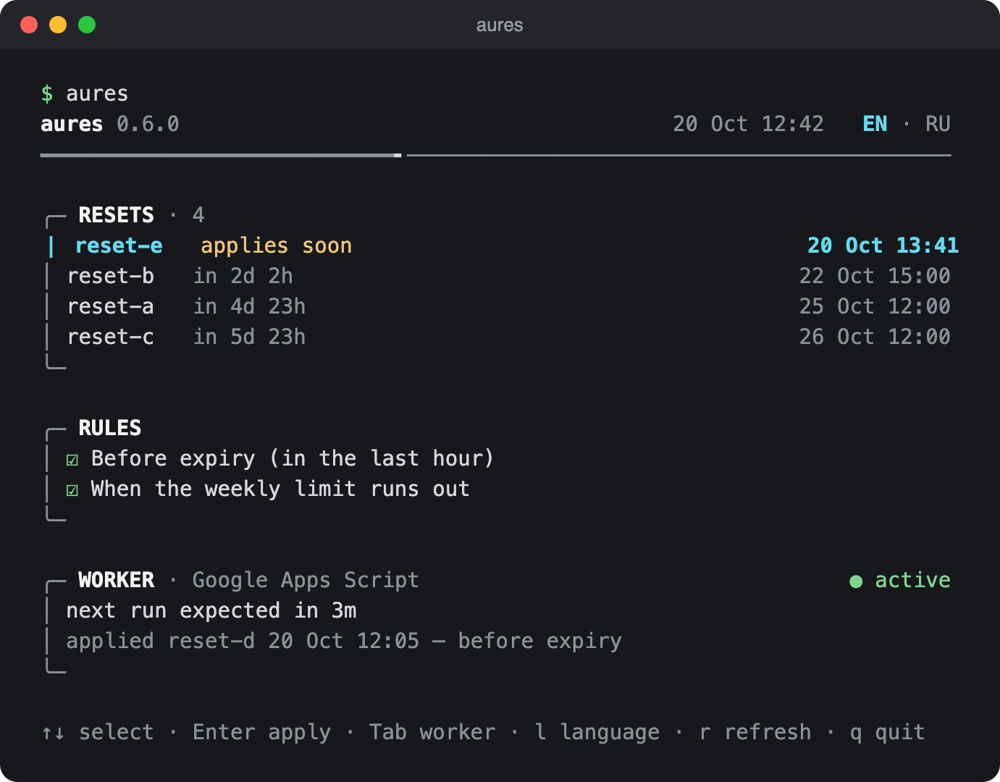
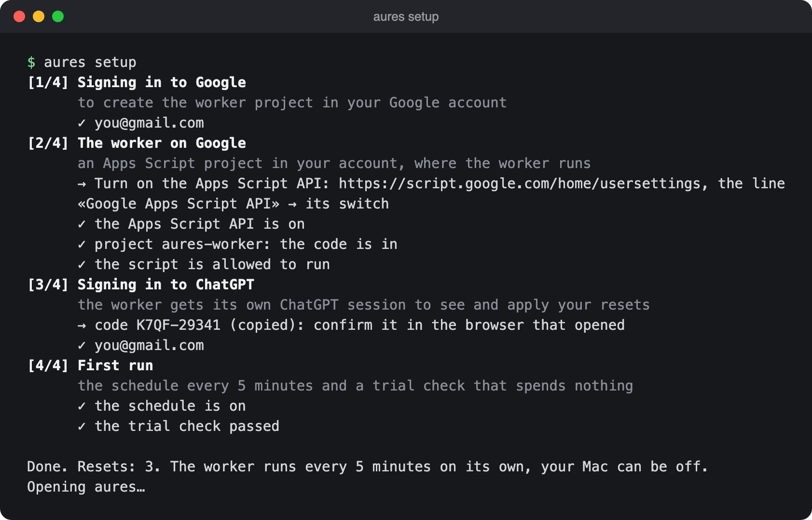
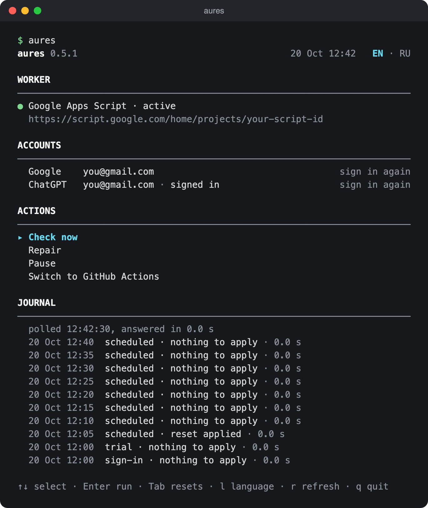
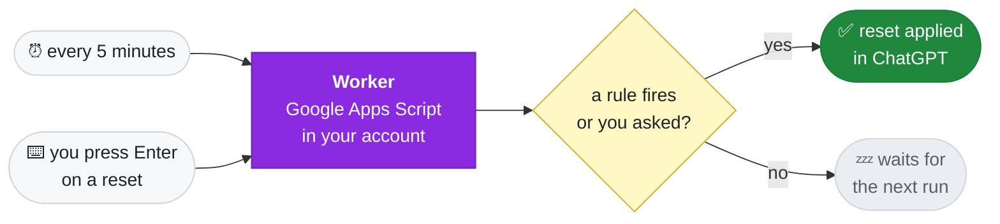

<div align="center">


### AUto-RESets for Codex

Applies your issued ChatGPT rate-limit resets so they don't go to waste.<br>
Runs in your own Google account, on Google Apps Script. Your Mac can be off.

[](https://github.com/Keshaqaz/aures/releases/latest)
[](docs/installation.en.md)
[](docs/installation.en.md)
[](LICENSE)

**English** · [Русский](docs/README.ru.md)



</div>

## Features

- **No reset expires unused.** The worker applies a reset in the last hour before it expires.
- **Weekly limit hit — reset within minutes.** An optional rule applies the reset that expires first. The worker checks the limit itself every 5 minutes, even with the Mac off, whichever client used it up: Codex, opencode, your phone.
- **One screen.** `aures` shows the resets on top, the rules and the worker's state below. Enter on a reset applies it now, regardless of the rules; Enter on a rule switches it. `Tab` opens the «Worker» screen: the worker and its state, the accounts, «Check now» (a trial run that applies nothing), «Repair» (deploys this version of the worker again and brings its schedule back), «Pause» (the schedule off; «Apply now» still works) and the live journal of the worker, polled while the screen is open. The screen and the pause are detailed in the [guide](docs/installation.en.md).
- **No servers, no subscriptions.** Everything runs in your Google account, within ~5–10 of the 90 free trigger-minutes a day.
- **Codex on your Mac is untouched.** The worker has a ChatGPT sign-in of its own; nothing is copied from Codex.

> [!IMPORTANT]
> ### 🔒 Your tokens never leave your accounts
>
> AURES has no server of its own and collects nothing. Everything runs on **your** Mac and in **your** Google account:
>
> - **The Google sign-in and the worker secret** stay in your Mac's Keychain.
> - **The worker's ChatGPT sign-in** lives in your script project's properties, unencrypted — a key would sit right next to it. The worker's web app answers only requests with the secret from your Keychain and never returns tokens.
> - The CLI and the worker talk to Google and OpenAI only. No telemetry, no third parties, not even the author.
>
> The code is open: see for yourself in [src/](src/).

## Quick start

```sh
brew install keshaqaz/tap/aures
aures setup
```

`setup` goes in stages, each telling what it does and why: `[1/4] Signing in to Google`, `[2/4] The worker on Google`, `[3/4] Signing in to ChatGPT`, `[4/4] First run`. It opens every page itself, and when it is done the main screen opens. What to click on each Google screen is in the [guide](docs/installation.en.md#quick-install).



The CLI speaks your Mac's language — Russian on a Russian locale, English on any other; `l` on the screen or `aures language` switches it.

Full guide, including installing from source: [docs/installation.en.md](docs/installation.en.md).

> [!NOTE]
> **Had a worker on GitHub?** Versions before 0.6.0 could run it on GitHub Actions. Delete its private repository `codex-auto-resets-worker` on GitHub by hand (its schedule keeps running until you do), then run `aures setup`. Details in the [guide](docs/installation.en.md#had-a-worker-on-github).

## Commands

| Command | What it does |
| --- | --- |
| *(no command)* | the screen: resets and rules; Enter applies a reset or switches a rule; `Tab` — the «Worker» screen: check, repair, pause, the journal |
| `setup` | install, or finish an interrupted install |
| `status` | the same overview printed once: resets, rules and worker health |
| `apply-now` | apply a chosen reset now |
| `rules` | choose when resets are applied |
| `login` | sign the worker in to ChatGPT again |
| `upgrade` | update the worker after a new version |
| `uninstall` | remove the worker and the sign-ins |
| `language en` / `language ru` | the language of the CLI; `l` on the screen does the same |

## The «Worker» screen

`Tab` on the screen opens the worker itself:

<div align="center">

</div>

- **Worker** — its state on the right (active, paused, last run failed, no scheduled run, no schedule, not run yet) and a link to the script project.
- **Accounts** — the Google account and the worker's ChatGPT sign-in; Enter on either signs in again.
- **Actions** — «Check now» (a trial run that applies nothing), «Repair» (deploys this version of the worker again and brings its schedule back) and «Pause» / «Unpause» (the schedule off and back on; «Apply now» still works on pause). Hold the cursor on an action for a moment and its caption opens under the row: what it does and what it leaves alone.
- **Journal** — the last runs of the worker, newest first, in three columns: when, who started it (the schedule or you) and what came of it. It is polled every 30 seconds while the screen is open.

The line under the header fills up from the last scheduled run to the next one. Only what is going on moves: a runner down the journal's bracket while the worker is read, the bracket of a section filling up while an action runs (or a runner going round it when its time is unknown). `AURES_MOTION=off` keeps the screen still.

Details in the [guide](docs/installation.en.md#the-worker-screen).

## How it works



**The worker** is a Google Apps Script project in your account. A trigger runs it every 5 minutes: it reads the limits and the resets, checks them against the rules and applies one when it's due. The Mac isn't needed for that: it only installs and controls the worker. Design: [ADR-0007](docs/adr/0007-two-worker-platforms.md), [ADR-0009](docs/adr/0009-google-only-worker.md).

| Rule | Default | When a reset is applied |
| --- | --- | --- |
| Before expiry | on | less than one hour is left before it expires |
| When the weekly limit runs out | on | the weekly limit is used up; the reset that expires first goes |

Both rules cover all resets and work independently; change them with `aures rules`.

## Limitations

- **A Google account is required.** At install time and on later sign-ins Google shows two «unverified app» warnings, once you turn on the Apps Script API switch, and on uninstall you delete the script project by hand.
- **Paid ChatGPT plan required**, with 5-hour and weekly limits. On a plan with a single monthly limit the weekly rule never fires.
- **macOS only.** The CLI keeps its sign-ins in the Keychain.
- **The worker's state is not encrypted.** The worker's ChatGPT sign-in lives in the script project's properties: a key would sit right next to it ([ADR-0007](docs/adr/0007-two-worker-platforms.md)). The web app answers only requests with the secret from your Keychain.
- **A real reset applied by the worker has not been verified live yet.** Reading resets and limits, sign-in and the apply request have been; details in [ADR-0004](docs/adr/0004-github-only-worker.md).

## Documentation

[Installation](docs/installation.en.md) ·
[Design: ADR-0007](docs/adr/0007-two-worker-platforms.md), [ADR-0009](docs/adr/0009-google-only-worker.md) ·
[Glossary (ru)](docs/CONTEXT.md) ·
[Releasing (ru)](docs/releasing.md)

## Development

```
src/
  cli/         aures commands and the screens; launch-agent removes what the Mac check of earlier versions left
  worker/      the tick, the rules, the state and the summary
  apps-script/ the worker on Google Apps Script: runtime, doPost actions, journal
  chatgpt/     ChatGPT device sign-in, resets and limits over HTTP
  google/      Google OAuth client and the Apps Script API
scripts/       worker build and Homebrew release
test/          tests; support/ — fixtures
docs/          guides, glossary, adr/
```

```sh
npm ci
npm test                          # offline, no network or credentials
npm run typecheck                 # tsc type check, no build; Node runs the .ts directly
npm run build:worker              # dist/apps-script/worker.js, which setup and upgrade deploy
node src/cli/main.ts status       # CLI from source
npm run release:brew              # Homebrew archive and formula, see docs/releasing.md
```

Screenshots show the real CLI output on the synthetic data from the tests.

## License

[MIT](LICENSE) · third-party notices in [NOTICES.md](docs/NOTICES.md).
Unofficial project, not affiliated with OpenAI.
