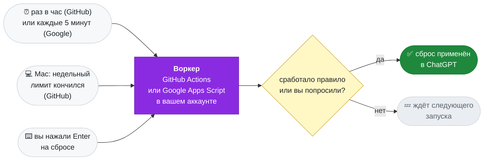

<div align="center">


### AUto-RESets for Codex

Сам применяет выданные сбросы лимита ChatGPT, чтобы они не сгорали.<br>
Работает в вашем аккаунте — на GitHub Actions или в Google Apps Script. Компьютер можно выключить.

[](https://github.com/Keshaqaz/aures/releases/latest)
[](installation.md)
[](installation.md)
[](../LICENSE)

[English](../README.md) · **Русский**


</div>

## Что умеет

- **Сброс не сгорит.** Воркер применит сброс до истечения срока: в последние 8 часов на GitHub, в последний час на Google.
- **Кончился недельный лимит — сброс через минуты.** Правило можно включить: воркер применит сброс с ближайшим сроком. На Google воркер сам проверяет лимит каждые 5 минут, даже когда Mac выключен; на GitHub, пока Mac не спит, лимит раз в 2 минуты проверяет Mac и зовёт воркера, в каком бы клиенте лимит ни израсходовали: Codex, opencode, телефон.
- **Один экран.** `aures` показывает сбросы сверху и правила снизу. Enter на сбросе применяет его сейчас, без всяких правил; Enter на правиле переключает его. `Tab` открывает экран «Воркер»: площадка с её состоянием, аккаунты, «Проверить сейчас» (пробный запуск, ничего не применяет), «Починить» (заново заливает текущую версию воркера и возвращает расписание), «Пауза» (расписание снято, «Применить сейчас» работает), «Переключиться на …» (другая площадка без переустановки) и живой журнал воркера, который опрашивается, пока экран открыт. Экран, пауза и переключение подробно — в [инструкции](installation.md).
- **Без серверов и подписок.** Всё в вашем аккаунте: GitHub Actions (до ~750 минут в месяц из 2000 бесплатных) или Google Apps Script (~5–10 минут триггеров в сутки из 90 бесплатных).
- **Codex на Mac не затронут.** У воркера и у проверки с Mac свои входы в ChatGPT, данные Codex не копируются.

> [!IMPORTANT]
> ### 🔒 Ваши токены никуда не уходят
>
> У AURES нет своего сервера, он ничего не собирает. Всё работает на **вашем** Mac и в **вашем** аккаунте — GitHub или Google:
>
> - **Входы площадок** — GitHub, а на Google ещё вход в Google и секрет воркера — хранятся в связке ключей (Keychain) вашего Mac.
> - **Вход воркера в ChatGPT** на GitHub лежит в вашем приватном репозитории, зашифрованный AES-256-GCM; ключ — секрет Actions, который может прочитать только ваш собственный workflow. На Google он лежит в свойствах вашего проекта скрипта, без шифрования — ключ лежал бы рядом; web app воркера отвечает только на запросы с секретом из Связки ключей и не возвращает токены.
> - **Вход проверки с Mac в ChatGPT** хранится в файле на вашем Mac.
> - CLI и воркер обращаются только к GitHub, Google и OpenAI. Никакой телеметрии, никаких третьих сторон, даже автор проекта ничего не получает.
>
> Код открыт: проверьте сами в [src/](../src/).

## Быстрый старт

```sh
brew install keshaqaz/tap/aures
aures setup
```

CLI говорит на языке системы: русская локаль macOS — по-русски, любая другая — по-английски. Переключают язык `aures language` и клавиша `l` на экране.

`setup` спросит, где будет работать воркер — в Google Apps Script (каждые 5 минут) или на GitHub Actions (примерно раз в час), — и проведёт по этапам, по строке на этап: `[1/4] Площадка`, `[2/4] Вход в Google`, `[3/4] Воркер в Google`, `[4/4] Вход в ChatGPT`. Каждую страницу он открывает сам, а в конце открывается главный экран. Что нажимать на экранах Google — в [инструкции](installation.md#быстрая-установка).


Подробно, в том числе об установке из исходников, — в [инструкции](installation.md).

## Команды

| Команда | Что делает |
| --- | --- |
| *(без команды)* | экран: сбросы и правила; Enter применяет сброс или переключает правило; `Tab` — экран «Воркер»: проверка, починка, пауза, смена площадки, журнал |
| `setup` | установить (спросит площадку: GitHub или Google) или продолжить прерванную установку |
| `status` | то же одним выводом: сбросы, правила, состояние воркера и проверки с Mac |
| `apply-now` | применить выбранный сброс сейчас |
| `rules` | выбрать, когда применять сбросы |
| `login` | заново войти в ChatGPT, если воркер потерял вход |
| `upgrade` | обновить воркер после выхода новой версии |
| `uninstall` | удалить воркер, проверку с Mac и входы |
| `language en` / `language ru` | язык программы; на экране то же делает клавиша `l` |

## Экран «Воркер»

`Tab` на экране открывает сам воркер, на любой площадке:

<div align="center">

</div>

- **Воркер** — площадка, её состояние (активен, на паузе, переключение не завершено) и ссылка на репозиторий или проект скрипта.
- **Аккаунты** — аккаунт GitHub или Google и вход воркера в ChatGPT; Enter на любом из них — войти заново.
- **Действия** — «Проверить сейчас» (пробный запуск, ничего не применяет), «Починить» (заново заливает текущую версию воркера и возвращает расписание), «Пауза» / «Снять с паузы» (снять и вернуть расписание; «Применить сейчас» работает и на паузе) и «Переключиться на …» (переносит воркер на другую площадку без переустановки).
- **Журнал** — последние запуски воркера, новые сверху: что запустило и чем кончилось. Пока экран открыт, журнал опрашивается: на Google каждые 30 секунд, на GitHub каждую минуту.

Подробно — в [инструкции](installation.md#экран-воркер).

## Как это работает



**Воркер** живёт на выбранной при установке площадке: GitHub Actions запускает его примерно раз в час (с задержками), Google Apps Script — каждые 5 минут. Он сверяет сбросы с правилами и применяет нужный. Компьютер для этого не нужен: Mac участвует только в установке и управлении.

**Проверка с Mac** — агент launchd, который работает, пока включено недельное правило (на GitHub). Он читает недельный лимит отдельным входом Mac в ChatGPT и, как только лимит кончился, сразу запускает воркер, не дожидаясь планового запуска. Сам Mac сброс не применяет: воркер ещё раз читает лимит и решает по тем же правилам. На Google проверка не нужна: воркер сам следит за лимитом каждые 5 минут. Устройство — в [ADR-0005](adr/0005-weekly-check-from-mac.md).

| Правило | По умолчанию | Когда применяется сброс |
| --- | --- | --- |
| Перед истечением | включено | до истечения сброса осталось меньше 8 часов на GitHub или меньше часа на Google |
| Когда кончится недельный лимит | включено на Google, выключено на GitHub | недельный лимит израсходован; уходит сброс с ближайшим сроком |

Правила действуют на все сбросы сразу и независимо друг от друга; меняются командой `aures rules`.

## Ограничения

- **На GitHub время не точное.** GitHub задерживает и пропускает плановые запуски, иногда по нескольку часов, поэтому окно правила «перед истечением» — 8 часов. На Google воркер запускается каждые 5 минут, и окно — час.
- **Проверка с Mac (GitHub) работает, только пока Mac не спит** и вы вошли в свою учётную запись macOS. Иначе сброс применит плановый запуск, на часы позже. На Google проверка не нужна: воркер сам замечает конец лимита каждые 5 минут.
- **Ещё один код ChatGPT (GitHub).** При включении недельного правила нужно ещё раз войти в ChatGPT, уже для этого Mac. Вход хранится в файле, доступном вашему пользователю macOS. Выключение правила его не трогает, отзывает его `aures uninstall`.
- **Нужен платный план ChatGPT** с пятичасовым и недельным лимитами. Если у плана один месячный лимит, правило «когда кончится недельный лимит» не срабатывает.
- **Только macOS.** CLI хранит входы в Связке ключей.
- **Широкий доступ к GitHub.** Вход в GitHub даёт CLI доступ ко всем вашим репозиториям, как у `gh`.
- **Цена Google.** При установке и повторных входах Google дважды предупреждает о непроверенном приложении, один раз нужно включить переключатель API скрипта, а проект скрипта при удалении удаляется вручную.
- **Состояние воркера на Google не зашифровано.** Вход воркера в ChatGPT лежит в свойствах проекта скрипта: ключ лежал бы рядом ([ADR-0007](adr/0007-two-worker-platforms.md)). Web app отвечает только на запросы с секретом из вашей Связки ключей.
- **Применение настоящего сброса воркером вживую пока не проверено.** Чтение сбросов и лимитов, вход и запрос применения проверены, подробности — в [ADR-0004](adr/0004-github-only-worker.md).

## Документация

[Установка](installation.md) ·
[Устройство: ADR-0004](adr/0004-github-only-worker.md), [ADR-0005](adr/0005-weekly-check-from-mac.md), [ADR-0007](adr/0007-two-worker-platforms.md) ·
[Словарь](CONTEXT.md) ·
[Выпуск версии](releasing.md)

## Разработка

```
src/
  cli/        команды aures; watch, mac-check, launch-agent — проверка с Mac
  worker/     воркер: запуск, правила, шифрованный state, сводка, workflow
  apps-script/ воркер на Google Apps Script: рантайм, действия doPost, журнал
  chatgpt/    вход в ChatGPT по коду, сбросы и лимиты по HTTP
  github/     GitHub API и OAuth App
  google/     OAuth-клиент Google и Apps Script API
scripts/      сборка воркера и выпуск для Homebrew
test/         тесты; support/ — фикстуры
docs/         инструкции, словарь, adr/
```

```sh
npm ci
npm test                          # офлайн, без сети и учётных данных
npm run typecheck                 # проверка типов tsc без сборки; Node запускает .ts напрямую
npm run build:worker              # dist/worker.mjs, его кладут в репозиторий setup и upgrade
node src/cli/main.ts status       # CLI из исходников
node src/cli/main.ts watch        # один проход проверки с Mac, как его запускает агент
npm run release:brew              # архив и формула Homebrew, см. docs/releasing.md
```

На скриншотах — настоящий вывод CLI на синтетических данных из тестов.

## Лицензия

[MIT](../LICENSE) · сторонние компоненты — [NOTICES.md](NOTICES.md).
Неофициальный проект, не связан с OpenAI.
