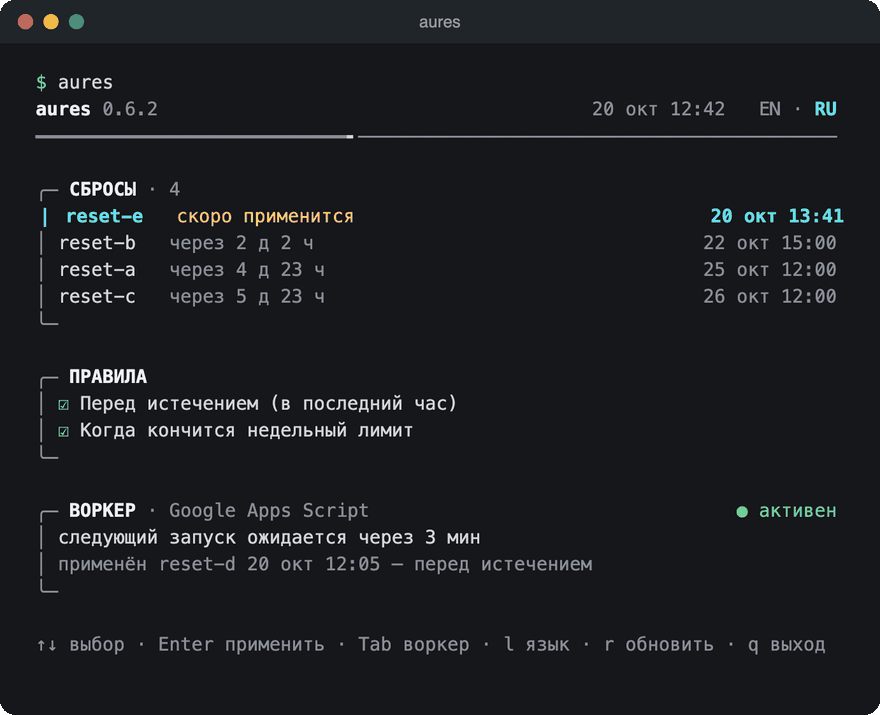
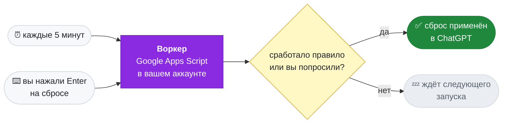

<div align="center">


### AUto-RESets for Codex

ChatGPT выдаёт сбросы лимита для Codex, и забытый сброс сгорает неиспользованным.<br>
AURES применяет каждый вовремя или сразу, как кончится недельный лимит:<br>
бесплатно, в вашем аккаунте Google, с выключенным Mac.

[](https://github.com/Keshaqaz/aures/releases/latest)
[](installation.md)
[](installation.md)
[](../LICENSE)

[English](../README.md) · **Русский**



</div>

## Что умеет

- **Сброс не сгорит.** Воркер применит сброс в последний час перед истечением срока.
- **Кончился недельный лимит — сброс через минуты.** Правило можно включить: воркер применит сброс с ближайшим сроком. Воркер сам проверяет лимит каждые 5 минут, даже когда Mac выключен, в каком бы клиенте лимит ни израсходовали: Codex, opencode, телефон.
- **Один экран.** `aures` показывает сбросы сверху, правила и состояние воркера снизу. Enter на сбросе применяет его сейчас, без всяких правил; Enter на правиле переключает его. `Tab` открывает экран «Воркер»: воркер и его состояние, аккаунты, «Проверить сейчас» (пробный запуск, ничего не применяет), «Починить» (заново заливает текущую версию воркера и возвращает расписание), «Пауза» (расписание снято, «Применить сейчас» работает) и живой журнал воркера, который опрашивается, пока экран открыт. Экран и пауза подробно — в [инструкции](installation.md).
- **Без серверов и подписок.** Всё в вашем аккаунте Google: ~5–10 минут триггеров в сутки из 90 бесплатных.
- **Codex на Mac не затронут.** У воркера свой вход в ChatGPT, данные Codex не копируются.

> [!IMPORTANT]
> ### 🔒 Ваши токены никуда не уходят
>
> У AURES нет своего сервера, он ничего не собирает. Всё работает на **вашем** Mac и в **вашем** аккаунте Google:
>
> - **Вход в Google и секрет воркера** хранятся в связке ключей (Keychain) вашего Mac.
> - **Вход воркера в ChatGPT** лежит в свойствах вашего проекта скрипта, без шифрования — ключ лежал бы рядом. Web app воркера отвечает только на запросы с секретом из Связки ключей и не возвращает токены.
> - CLI и воркер обращаются только к Google и OpenAI. Никакой телеметрии, никаких третьих сторон, даже автор проекта ничего не получает.
>
> Код открыт: проверьте сами в [src/](../src/).

## Быстрый старт

```sh
brew install keshaqaz/tap/aures
aures setup
```

CLI говорит на языке системы: русская локаль macOS — по-русски, любая другая — по-английски. Переключают язык `aures language` и клавиша `l` на экране.

`setup` проведёт по этапам, у каждого из которых сказано, что и зачем он делает: `[1/4] Вход в Google`, `[2/4] Воркер в Google`, `[3/4] Вход в ChatGPT`, `[4/4] Первый запуск`. Каждую страницу он открывает сам, а в конце открывается главный экран. Что нажимать на экранах Google — в [инструкции](installation.md#быстрая-установка).


Подробно, в том числе об установке из исходников, — в [инструкции](installation.md).

> [!NOTE]
> **Был воркер на GitHub?** Версии до 0.6.0 умели запускать его на GitHub Actions. Удалите его приватный репозиторий `codex-auto-resets-worker` на GitHub вручную (пока он есть, его расписание работает), затем запустите `aures setup`. Подробно — в [инструкции](installation.md#был-воркер-на-github).

## Команды

| Команда | Что делает |
| --- | --- |
| *(без команды)* | экран: сбросы и правила; Enter применяет сброс или переключает правило; `Tab` — экран «Воркер»: проверка, починка, пауза, журнал |
| `setup` | установить или продолжить прерванную установку |
| `status` | то же одним выводом: сбросы, правила и состояние воркера |
| `apply-now` | применить выбранный сброс сейчас |
| `rules` | выбрать, когда применять сбросы |
| `login` | заново войти в ChatGPT, если воркер потерял вход |
| `upgrade` | обновить воркер после выхода новой версии |
| `uninstall` | удалить воркер и входы |
| `language en` / `language ru` | язык программы; на экране то же делает клавиша `l` |

## Экран «Воркер»

`Tab` на экране открывает сам воркер:

<div align="center">

</div>

- **Воркер** — его состояние справа (активен, на паузе, ошибка запуска, нет запусков по расписанию, нет расписания, ещё не запускался) и ссылка на проект скрипта.
- **Аккаунты** — аккаунт Google и вход воркера в ChatGPT; Enter на любом из них — войти заново.
- **Действия** — «Проверить сейчас» (пробный запуск, ничего не применяет), «Починить» (заново заливает текущую версию воркера и возвращает расписание) и «Пауза» / «Снять с паузы» (снять и вернуть расписание; «Применить сейчас» работает и на паузе). Задержите курсор на действии — под рядом откроется подпись: что оно делает и что не трогает.
- **Журнал** — последние запуски воркера, новые сверху, в три столбца: когда, кто запустил (расписание или вы) и что получилось. Пока экран открыт, журнал опрашивается каждые 30 секунд.

Линия под шапкой заполняется от последнего запуска по расписанию до следующего. Движется только то, что происходит: бегунок по скобе журнала, пока воркер читается, и скоба раздела, которая заполняется, пока идёт действие (или бегунок по ней, если время действия неизвестно). `AURES_MOTION=off` останавливает всё движение.

Подробно — в [инструкции](installation.md#экран-воркер).

## Как это работает



**Воркер** — проект Google Apps Script в вашем аккаунте. Триггер запускает его каждые 5 минут: он читает лимиты и сбросы, сверяет их с правилами и применяет нужный. Компьютер для этого не нужен: Mac участвует только в установке и управлении. Устройство — в [ADR-0007](adr/0007-two-worker-platforms.md) и [ADR-0009](adr/0009-google-only-worker.md).

| Правило | По умолчанию | Когда применяется сброс |
| --- | --- | --- |
| Перед истечением | включено | до истечения сброса осталось меньше часа |
| Когда кончится недельный лимит | включено | недельный лимит израсходован; уходит сброс с ближайшим сроком |

Правила действуют на все сбросы сразу и независимо друг от друга; меняются командой `aures rules`.

## Ограничения

- **Нужен аккаунт Google.** При установке и повторных входах Google дважды предупреждает о непроверенном приложении, один раз нужно включить переключатель API скрипта, а проект скрипта при удалении удаляется вручную.
- **Нужен платный план ChatGPT** с пятичасовым и недельным лимитами. Если у плана один месячный лимит, правило «когда кончится недельный лимит» не срабатывает.
- **Только macOS.** CLI хранит входы в Связке ключей.
- **Состояние воркера не зашифровано.** Вход воркера в ChatGPT лежит в свойствах проекта скрипта: ключ лежал бы рядом ([ADR-0007](adr/0007-two-worker-platforms.md)). Web app отвечает только на запросы с секретом из вашей Связки ключей.
- **Применение настоящего сброса воркером вживую пока не проверено.** Чтение сбросов и лимитов, вход и запрос применения проверены, подробности — в [ADR-0004](adr/0004-github-only-worker.md).

## Документация

[Установка](installation.md) ·
[Устройство: ADR-0007](adr/0007-two-worker-platforms.md), [ADR-0009](adr/0009-google-only-worker.md) ·
[Словарь](CONTEXT.md) ·
[Выпуск версии](releasing.md)

## Разработка

```
src/
  cli/         команды aures и экраны; launch-agent убирает то, что оставила проверка с Mac прежних версий
  worker/      тик, правила, состояние и сводка
  apps-script/ воркер на Google Apps Script: рантайм, действия doPost, журнал
  chatgpt/     вход в ChatGPT по коду, сбросы и лимиты по HTTP
  google/      OAuth-клиент Google и Apps Script API
scripts/       сборка воркера и выпуск для Homebrew
test/          тесты; support/ — фикстуры
docs/          инструкции, словарь, adr/
```

```sh
npm ci
npm test                          # офлайн, без сети и учётных данных
npm run typecheck                 # проверка типов tsc без сборки; Node запускает .ts напрямую
npm run build:worker              # dist/apps-script/worker.js, его разворачивают setup и upgrade
node src/cli/main.ts status       # CLI из исходников
npm run release:brew              # архив и формула Homebrew, см. docs/releasing.md
```

На скриншотах — настоящий вывод CLI на синтетических данных из тестов.

## Лицензия

[MIT](../LICENSE) · сторонние компоненты — [NOTICES.md](NOTICES.md).
Неофициальный проект, не связан с OpenAI.
