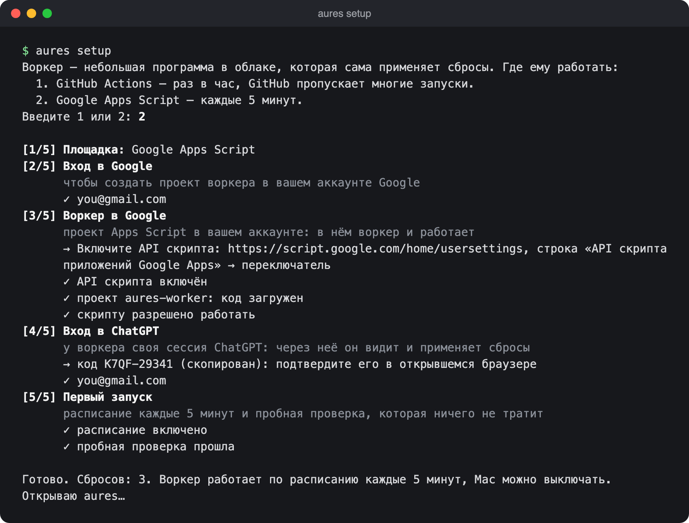
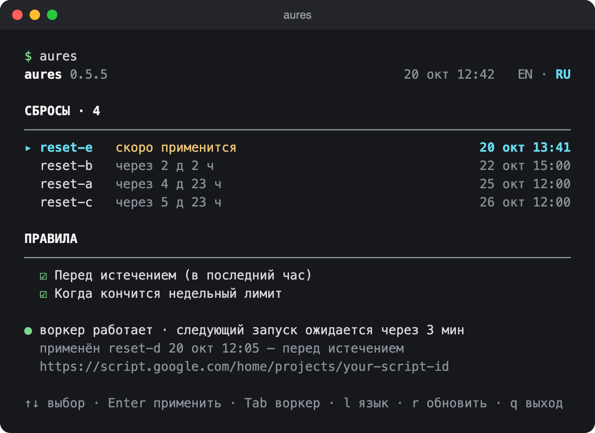
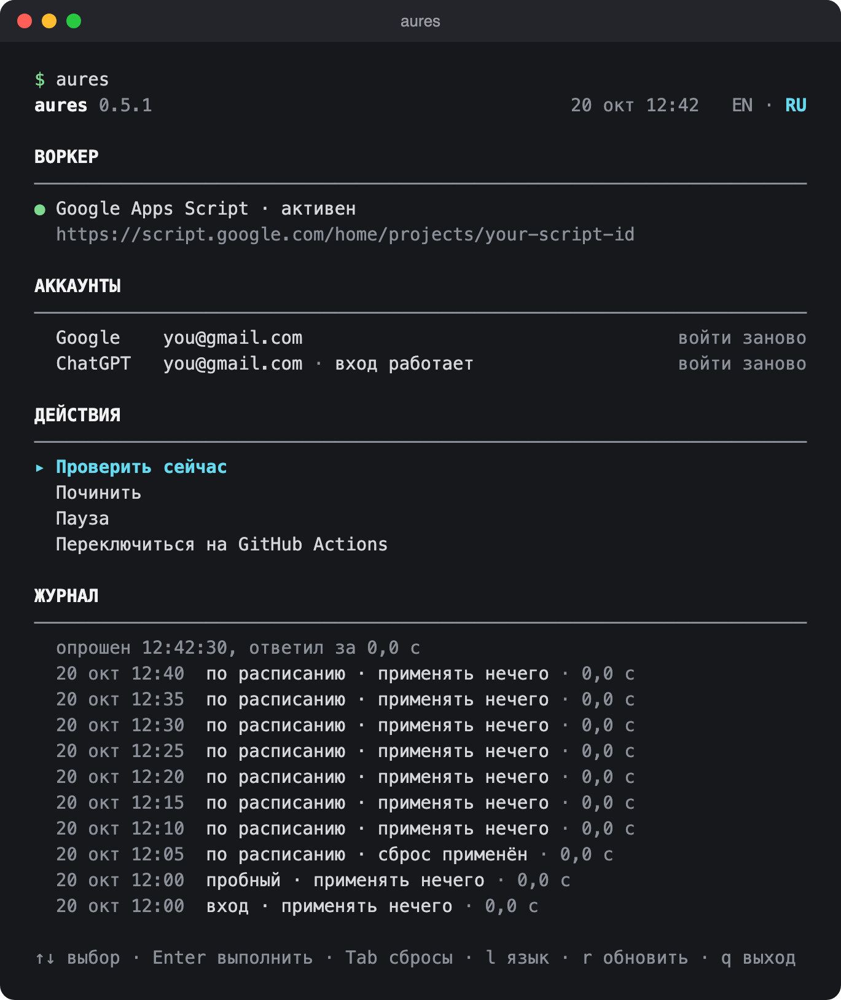

# Установка и использование

[English](installation.en.md) · **Русский**

## Быстрая установка

Нужны Mac, аккаунт Google или GitHub (там будет жить воркер) и платная подписка ChatGPT со сбросами.

```sh
brew install keshaqaz/tap/aures
aures setup
```

`setup` ведёт по этапам, по строке на этап; каждую страницу он открывает сам и сам продолжает, когда вы закончили. Сначала выберите площадку:

```
  1. GitHub Actions — раз в час, GitHub пропускает многие запуски.
  2. Google Apps Script — каждые 5 минут.
Введите 1 или 2:
```

Google точнее и проще: дальше — его этапы.

| Этап | Что сделать |
| --- | --- |
| `[1/5] Площадка` | Введите `2`. |
| `[2/5] Вход в Google` | Выберите аккаунт. На странице «Приложение не проверено Google»: «Дополнительные настройки» → «Перейти на страницу "aures" (небезопасно)». Затем «Продолжить» → «Выбрать все» → «Продолжить». |
| `[3/5] Воркер в Google` | Если попросит: на открывшейся странице нажмите переключатель «API скрипта приложений Google Apps». Затем на странице «aures-worker (Unverified)»: «Review permissions» → тот же аккаунт → «Дополнительные настройки» → «Перейти на страницу "aures-worker" (небезопасно)» → «Выбрать все» → «Продолжить». |
| `[4/5] Вход в ChatGPT` | Код уже в буфере: вставьте его на открывшейся странице и войдите в аккаунт со сбросами. |
| `[5/5] Первый запуск` | Ничего: расписание и пробная проверка. |

У каждого этапа есть строка «зачем», его шаги отмечаются `✓`, а то, что нужно сделать вам, — строкой `→`. В конце — `Готово. Сбросов: N.`, и открывается главный экран aures.



Оба предупреждения Google о «непроверенном приложении» ожидаемы: и приложение aures, и скрипт воркера — ваши, Google их просто не проверял. Если этап ждёт дольше ~30 секунд, `setup` печатает подсказку с кнопками и ссылку на случай, если браузер не открылся. Прерванный `setup` просто запустите снова — он продолжит с того же места.

### На GitHub

| Этап | Что сделать |
| --- | --- |
| `[1/5] Площадка` | Введите `1`. |
| `[2/5] Вход в GitHub` | Код уже в буфере: вставьте его на открывшейся странице и разрешите доступ. |
| `[3/5] Репозиторий воркера` | Ничего: в аккаунте появится приватный репозиторий `codex-auto-resets-worker`. |
| `[4/5] Вход в ChatGPT` | Как на Google. |
| `[5/5] Первый запуск` | Выберите правила (Enter — оставить как есть). Если включили «Когда кончится недельный лимит», `setup` попросит ещё один код ChatGPT — для этого Mac (см. [Проверка с Mac](#проверка-с-mac)). Дальше расписание и пробный запуск. |

### Из исходников

Нужен Node 26:

```sh
git clone https://github.com/Keshaqaz/aures.git && cd aures
npm ci && npm run build:worker
echo "alias aures='node $PWD/src/cli/main.ts'" >> ~/.zshrc && source ~/.zshrc
```

### Язык

CLI говорит на языке системы. Сменить: `aures language ru` / `aures language en` или клавиша `l` на экране.

## Каждый день

```sh
aures
```



Сверху сбросы со сроками, снизу правила, под ними — строка о воркере.

- `↑` `↓` — выбрать строку.
- `Enter` на сбросе — применить сейчас (`y` — подтвердить). Сброс одноразовый, отменить нельзя.
- `Enter` на правиле — включить или выключить.
- `Tab` — экран «Воркер».
- `l` — язык, `r` — обновить, `q` — выйти.

Если что-то не так, внизу появится строка с `!` и подсказкой. `aures status` печатает то же самое один раз.

## Правила

| Правило | По умолчанию | Что делает |
| --- | --- | --- |
| Перед истечением | включено | Применяет сброс в последний час до истечения на Google, в последние 8 часов на GitHub. |
| Когда кончится недельный лимит | включено на Google, выключено на GitHub | Как только недельный лимит кончился, применяет сброс с ближайшим сроком. |

Правила действуют на все сбросы и заработают со следующего запуска воркера. Менять — на экране `aures` или командой `aures rules`.

## Экран «Воркер»



`Tab` открывает и закрывает его. Здесь:

- **Воркер** — площадка, её состояние и ссылка на репозиторий или проект.
- **Аккаунты** — GitHub или Google и ChatGPT; у каждого «войти заново».
- **Действия:**
  - «Проверить сейчас» — пробный запуск: воркер читает сбросы и говорит, что сделали бы правила, ничего не тратя.
  - «Починить» — заново залить текущую версию воркера и вернуть расписание. Сбросы, правила и вход не трогаются.
  - «Пауза» / «Снять с паузы» — снимает или возвращает расписание. На паузе правила не работают и сбросы сгорают в свой срок; «Применить сейчас» работает.
  - «Переключиться на …» — перенести воркер на другую площадку (ниже).
- **Журнал** — последние запуски воркера: когда, по какой причине, чем кончились. Пока экран открыт, обновляется сам.

### Смена площадки

«Переключиться на …» готовит новый воркер, пока старый работает (вход в новую площадку и в ChatGPT, как при установке), затем гасит старый и включает новый. `Esc` до гашения отменяет всё. Если переключение прервалось, на экране останется одно действие — «Повторить переключение». Если у воркера есть применение сброса с неизвестным исходом, переключение подождёт его следующего запуска, чтобы не потратить второй сброс.

## Проверка с Mac

Только для GitHub с включённым недельным правилом. GitHub запускает воркер неточно, поэтому конец недельного лимита замечает Mac: агент launchd раз в 2 минуты читает лимит (это ничего не тратит) и, когда тот кончился, запускает воркер. Сброс применяет сам воркер. Работает, пока Mac не спит; лог — `~/Library/Logs/codex-auto-resets/watch.log`.

На Google проверка не нужна: воркер сам смотрит лимит каждые 5 минут, даже когда Mac выключен.

<details>
<summary>Строки watch.log</summary>

| Строка | Что значит |
| --- | --- |
| `idle`, `quiet` | Лимит не кончился, или на это окно воркер уже запускали. |
| `dispatched`, `dispatched (2 of 3)` | Лимит кончился, воркер запущен (повторно, если лимит не обновился). |
| `no_resets` | Лимит кончился, но сбросов нет. |
| `paused`, `switching` | Воркер на паузе или переключение площадки не завершено. |
| `transient_error: …` | ChatGPT временно не ответил; следующий проход повторит. |
| `reauth_required…`, `no_session` | Входа Mac в ChatGPT нет: `aures setup`. |
| `no_github_token`, `github_error: …`, `no_worker`, … | Проблема со входом в GitHub или репозиторием: подробности в `aures status`. |

</details>

## Если что-то сломалось

При ошибке воркера площадка присылает письмо. Запустите `aures status` — он скажет причину и что делать.

| Сообщение | Что сделать |
| --- | --- |
| Воркер потерял вход в ChatGPT | `aures login` |
| Воркер устарел | `aures upgrade` |
| Установка не завершена; воркер на Google не отвечает | `aures setup` |
| У воркера нет расписания | «Починить» на экране «Воркер» |
| Воркер выключен в GitHub | По ссылке из сообщения — **Enable workflow** |
| Воркер / GitHub / Google не запускал воркер N ч | Проверьте Actions или выполнения скрипта по ссылке из сообщения |
| Скрипту выданы не все доступы | `aures setup` откроет согласие снова: отметьте обе галочки |
| Это другой аккаунт ChatGPT | Войдите в аккаунт, для которого ставили воркер, или переустановите: `uninstall`, затем `setup` |
| Вход этого Mac в ChatGPT потерян | `aures setup` |

## Обновление

```sh
brew upgrade aures
aures upgrade
```

`aures upgrade` обновляет сам воркер; правила, журнал и вход в ChatGPT сохраняются. На Google он может снова попросить вход в Google, если тот отозван, — те же кнопки, что при установке. Из исходников: `git pull && npm ci && npm run build:worker`, затем `aures upgrade`.

С версии до 0.3.0 (`codex-auto-resets`) обновитесь один раз по полному имени: `brew update && brew upgrade keshaqaz/tap/aures && aures upgrade`.

## Удаление

```sh
aures uninstall
brew uninstall aures
```

`uninstall` спросит подтверждение, остановит воркер, отзовёт его вход в ChatGPT и уберёт всё, что относится к aures на этом Mac.

- **GitHub:** попросит ещё раз войти в GitHub, чтобы удалить репозиторий. В конце откройте ссылку и нажмите **Revoke**.
- **Google:** вход aures в Google отзывается для всего аккаунта, так что на другом Mac следующий `upgrade` попросит войти заново. Проект скрипта CLI удалить не может — в конце будет ссылка: перенесите `aures-worker` в корзину на script.google.com (или оставьте: он больше ничего не делает).

## Что где хранится

| Где | Что |
| --- | --- |
| Связка ключей Mac (служба `codex-auto-resets`) | вход в GitHub; на Google — вход в Google и секрет воркера |
| Репозиторий `codex-auto-resets-worker` (GitHub) | воркер, расписание, правила, сводка сбросов и зашифрованный вход воркера в ChatGPT |
| Проект `aures-worker` (Google) | воркер, расписание, правила, журнал и вход воркера в ChatGPT (в Script Properties) |
| `~/Library/Application Support/codex-auto-resets/` | площадка и адрес воркера, выбор языка; для проверки с Mac — её вход в ChatGPT и состояние |
| `~/Library/LaunchAgents/com.github.keshaqaz.codex-auto-resets.watch.plist` | агент проверки с Mac |

Репозиторий воркера должен оставаться приватным. Web app воркера на Google отвечает только на запросы с секретом из Связки ключей вашего Mac и не отдаёт токены. Подробнее о безопасности — [ADR-0005](adr/0005-weekly-check-from-mac.md) и [ADR-0007](adr/0007-two-worker-platforms.md).

## Сколько это стоит

Ничего. GitHub: до ~750 минут Actions в месяц из 2000 бесплатных. Google: 5–10 минут триггеров в сутки из 90. Если у вас есть другие Actions или скрипты, учитывайте общий расход.
